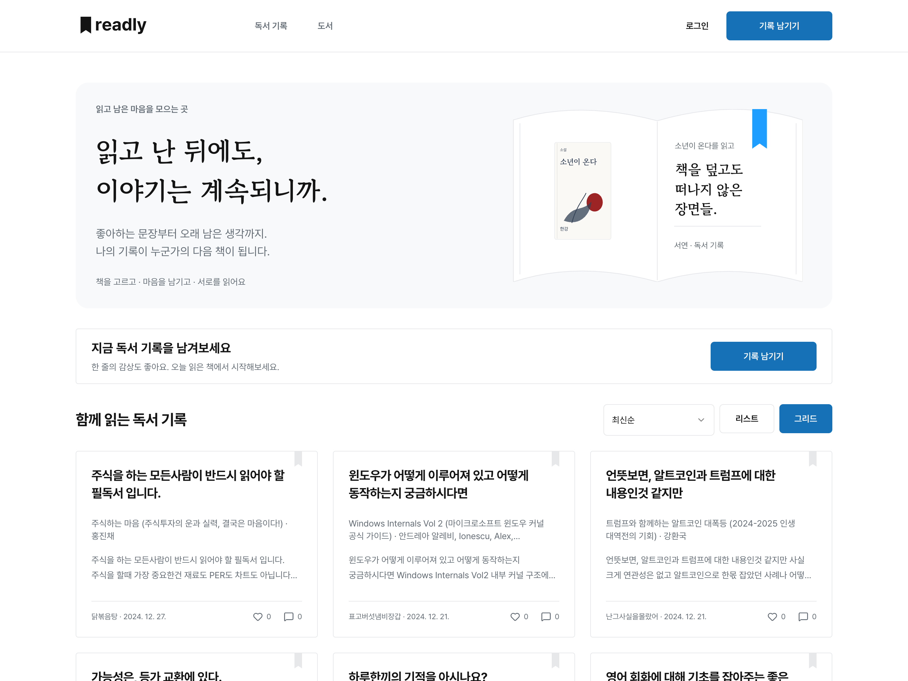
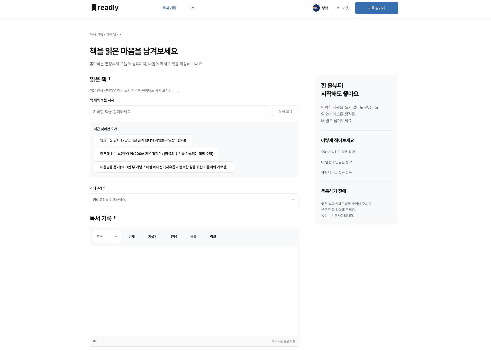
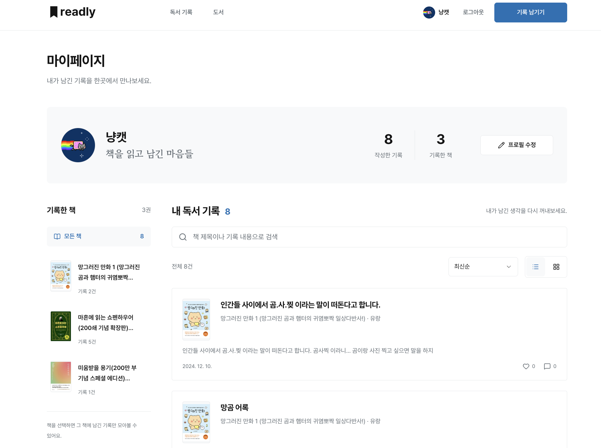
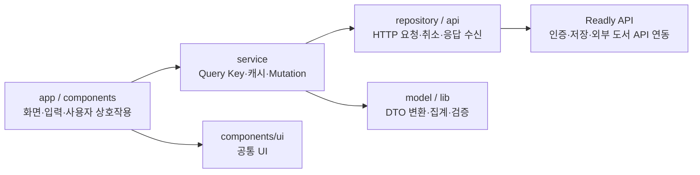

# Readly

**읽은 책의 생각을 기록하고, 같은 책을 읽은 사람들과 나누는 독서 기록 서비스**

도서 검색 → 기록 작성 → 다른 독자의 기록 탐색 → 내 기록 관리로 이어지는 웹 애플리케이션입니다.
기존 서비스를 반응형 UI로 개편하면서 데이터 조회, 에디터 렌더링, API 예외 처리와 회귀 테스트를 함께 개선했습니다.

[서비스 바로가기](https://readly.createdoodle.dev/) · [설계와 문제 해결](#설계와-문제-해결) · [성능 개선 기록](docs/performance.md) · [로컬 실행](#로컬-실행)



## 구현 범위

이 저장소는 Readly의 **프론트엔드**입니다. 반응형 화면과 공통 UI, 서버 상태 관리, API 연동, 기록 편집과 사용자 입력 검증을 다룹니다.
백엔드는 [별도 저장소](https://github.com/hanatailedtit/readly-api)로 분리되어 있습니다.

| 사용자 흐름 | 구현 내용 |
| --- | --- |
| 책을 고르기 | 도서 검색·페이지 이동, 최근 찾아본 도서, PC 8개·모바일 4개 검색 결과 표시 |
| 생각을 남기기 | Tiptap 서식 편집, 카테고리 선택, 책 전체·일부 쪽수 기록, 필수값·쪽수 범위 검증 |
| 다른 독자를 만나기 | 기록 검색·필터·정렬, 그리드·리스트 전환, 좋아요, 댓글·답글, 링크·카카오 공유 |
| 책을 중심으로 탐색하기 | 도서 목록의 서버 페이지네이션, 기록이 달린 도서 필터, 같은 책의 기록 모아보기 |
| 내 기록을 관리하기 | Google 로그인, 도서별 필터·본문 검색·정렬, 프로필 사진·닉네임 통합 편집 |

<details>
<summary>기록 작성과 반응형 마이페이지 화면 보기</summary>

### 기록 작성



### 마이페이지 · 데스크탑과 모바일

<table>
  <tr>
    <th width="75%">데스크탑 · 도서별 필터와 기록 목록</th>
    <th width="25%">모바일 · 필터와 조작 요소 재배치</th>
  </tr>
  <tr>
    <td valign="top"></td>
    <td valign="top"></td>
  </tr>
</table>

[화면 이미지 출처](docs/images/readme/README.md)

</details>

## 기술 구성

| 영역 | 기술 | 적용한 역할 |
| --- | --- | --- |
| 애플리케이션 | Next.js 15 App Router · React 18 · TypeScript | 경로별 화면, 공통 레이아웃, API DTO와 화면 모델의 타입 정의 |
| 서버 상태 | TanStack Query v5 · Axios | 조회 조건별 캐시, 변경 후 무효화, 요청 취소·재시도 정책 |
| UI | Tailwind CSS · shadcn/ui · Radix UI | 공통 디자인 토큰, 반응형 배치, 다이얼로그·선택 UI·키보드 조작 |
| 본문 편집·표시 | Tiptap · DOMPurify | 기존 HTML을 읽는 편집기와 저장된 본문의 HTML 정제 |
| 검증·개발 도구 | Node.js Test Runner · ESLint · TypeScript · Storybook | 데이터·요청 동작의 회귀 테스트, 정적 검사, 공통 컴포넌트 예제 확인 |

### 데이터 흐름과 책임 분리



화면의 검색어·선택·페이지는 React 상태로, API 조회 결과와 수명은 TanStack Query로 관리합니다.
HTTP 요청은 `repository`, 날짜·작성자·도서 데이터의 화면용 변환은 `model`, 필터·집계·검증은 `lib`로 분리했습니다.
컴포넌트가 서버 응답 형식과 캐시 갱신 규칙을 모두 떠안지 않도록 역할을 나눴습니다.

## 설계와 문제 해결

### 1. 상세 화면에서 전체 기록을 조회하던 비용 줄이기

**문제:** 한 책의 기록을 보여주기 위해 전체 기록을 내려받아 집계하면, 다른 책의 기록이 늘어도 상세 조회 비용이 함께 증가했습니다.

**해결:** 책 제목으로 조회 범위를 좁히고 ISBN으로 다른 판본을 제외했습니다. 기록 상세에서 얻은 도서 정보를 캐시에 저장해 도서 상세에서 재사용하고, 정보가 적은 목록 응답이 기존 상세 캐시를 덮어쓰지 않도록 했습니다.

| 확인 항목 | 개선 전 | 개선 후 |
| --- | --- | --- |
| 상세 화면의 도서별 기록 조회 | 전체 기록 10회 / 1,000건 | 제목 검색 2회 / 125건 |
| 기록 상세 → 도서 상세 이동 | 전체 카탈로그에 의존 | 캐시가 유효하면 추가 API 요청 0회 |
| 사용 글꼴 4개의 파일 용량 합계 | 12,913,428B | 2,915,780B · **77.4% 감소** |

API 수치는 **전체 기록 1,000건·8개 도서·대상 도서 기록 125건의 로컬 모의 응답** 기준입니다.
글꼴은 글자 부분집합을 만들지 않고 WOFF2로 변환한 파일 크기 비교입니다. 운영 응답 시간이나 LCP 개선율을 뜻하지 않습니다.
측정 조건과 추가 개선 내용은 [성능 개선 기록](docs/performance.md)에 정리했습니다.

캐시 정책도 데이터별로 구분했습니다. 기본 조회 30초, 도서 검색 5분, 도서 정보 30분을 적용하고,
TanStack Query의 조회 취소 신호를 Axios에 전달했습니다. 4xx 오류는 자동 재시도하지 않으며,
좋아요·댓글 변경 시에는 관련 캐시를 갱신해 전체 카탈로그의 즉시 재조회를 피했습니다.

관련 코드: [QueryClient 정책](src/lib/react-query.ts) · [도서별 조회](src/repository/book.repository.ts) · [캐시와 무효화](src/service/book.service.ts) · [회귀 테스트](tests/performance.test.cjs)

### 2. 기존 글의 형식을 보존하면서 에디터 교체하기

**문제:** 편집기를 교체해도 기존 HTML에 저장된 링크·이미지·표·텍스트 서식을 읽을 수 있어야 했습니다. 본문을 입력할 때마다 전체 작성 폼이 다시 렌더링되는 비용도 줄일 필요가 있었습니다.

**해결:** Tiptap에 기존 콘텐츠를 읽는 확장을 구성하고, 본문은 `ref`에 보관했습니다.
`shouldRerenderOnTransaction: false`와 `useEditorState`를 사용해 툴바에 필요한 상태를 구독하도록 구성했습니다.
상세 화면은 저장된 HTML을 DOMPurify로 정제하고, 링크 입력은 `http`·`https` URL로 제한했습니다.

관련 코드: [본문 편집기](src/components/records/rich-editor.tsx) · [작성 폼](src/components/records/record-editor.tsx) · [본문 정제](src/components/records/safe-content.tsx)

### 3. API 예외와 부분 실패에서도 사용 흐름 유지하기

정상 응답뿐 아니라 실제로 화면을 깨뜨리는 경계 조건을 처리했습니다.

| 발생 조건 | 대응 |
| --- | --- |
| 발행일이 비었거나 유효하지 않은 검색 결과 | 날짜 변환 예외로 전체 검색이 실패하지 않도록 빈 날짜로 정규화 |
| ISBN이 없거나 같은 값인 검색 결과 | ISBN만 React key로 사용하지 않고 대체 정보와 인덱스를 조합해 충돌 방지 |
| 서버가 중복 페이지를 반환 | 기록 ID를 중복 제거하고 새 기록이 없는 응답에서 반복 조회 종료 |
| 재조회 후 기록 수가 줄어 마지막 페이지가 사라짐 | 유효한 페이지 범위로 표시 위치 보정 |
| 닉네임 저장 성공 후 이미지 업로드 실패 | 부분 성공을 안내하고 입력·저장 상태를 유지해 재시도 지원 |

이 중 날짜 변환, 중복 페이지, 집계·필터 동작은 단위·요청 계층 테스트로 검증합니다.
프로필 사진 미리보기는 파일 변경·닫기 시 Object URL을 해제하고, 업로드 중에는 중복 저장과 닫기를 막도록 구성했습니다.

관련 코드: [도서 데이터 변환](src/model/book/book.dto.ts) · [목록 페이지](src/components/books/book-directory.tsx) · [프로필 편집](src/components/profile/profile-edit-dialog.tsx)

### 4. 화면 개편을 공통 UI와 접근성으로 연결하기

Figma 수정본을 기준으로 레거시 컴포넌트·SCSS를 정리하고 shadcn/ui·Tailwind CSS로 화면을 구성했습니다.
색상·글꼴·간격은 공통 토큰으로 관리하며, 표지는 2:3 영역 안에서 원본 비율을 유지합니다.
모바일에서는 목록을 한 열로 배치하고, 마이페이지의 도서 사이드바를 선택 UI로 바꿉니다.

본문 바로가기, 입력 필드의 label, 아이콘 버튼의 접근 가능한 이름, 오류·로딩 상태 안내를 적용했습니다.
포인터 입력과 키보드 이동의 포커스 표시도 구분했습니다.

관련 코드: [디자인 토큰](src/app/globals.css) · [공통 UI](src/components/ui) · [마이페이지](src/app/my-page/[id]/page.tsx) · [디자인 원본](design/figma-revision-v2)

## 검증

Node.js 기본 테스트 러너로 외부 서버 없이 데이터 변환과 요청 동작을 확인합니다.

| 테스트 | 확인하는 동작 |
| --- | --- |
| [records.test.cjs](tests/records.test.cjs) | ISBN별 집계, 쪽수 검증, HTML 제목 변환, 외부 링크·로그인 복귀 경로 검증 |
| [performance.test.cjs](tests/performance.test.cjs) | 요청 취소, 캐시 재사용, 인증 오류 재시도 방지, 페이지 요청·중복 제거, 댓글 그룹화 |
| [profile.test.cjs](tests/profile.test.cjs) | 사용자별 기록 조회, 도서·본문 검색, 정렬, 중복 페이지 종료 |
| [book-model.test.cjs](tests/book-model.test.cjs) | 잘못된 발행일이 섞여도 전체 검색 결과와 메타데이터 보존 |

```sh
npm test                 # 데이터·요청 계층 회귀 테스트
npm run typecheck        # TypeScript 검사
npm run lint             # ESLint 검사
npm run build            # Next.js 프로덕션 빌드
npm run build-storybook  # Storybook 빌드
```

Google 로그인과 실제 저장·이미지 업로드를 포함한 동작은 백엔드 연결이 필요합니다.
위 테스트가 실제 OAuth 인증이나 외부 서비스 연동 전체를 검증하는 것은 아닙니다.

## 남은 과제

- **도서별 서버 집계:** 기록 수·최근 기록 날짜를 계산하는 전체 카탈로그는 아직 전체 기록을 조회합니다. 서버에서 ISBN별 집계를 페이지 단위로 제공하면 이 비용을 줄일 수 있습니다.
- **전체 도서의 전역 정렬:** 전체 도서 모드의 정렬은 현재 받아온 페이지 안에서 적용됩니다. 전체 데이터에 대한 순위 정렬에는 API의 정렬·집계 지원이 필요합니다.
- **개인 기록 검색의 서버 이관:** 마이페이지는 사용자 범위의 기록을 모두 받은 뒤 검색·필터링합니다. 기록이 많아지면 검색·필터·집계를 서버 페이지네이션과 함께 처리해야 합니다.

## 로컬 실행

```sh
npm ci
cp .env.example .env.local # 기존 .env.local이 없을 때만 실행
npm run dev
```

의존성은 `package-lock.json`을 기준으로 설치합니다. 개발 서버는 `http://localhost:3000`에서 시작합니다.

| 환경 변수 | 용도 |
| --- | --- |
| `NEXT_PUBLIC_READLY_API_URL` | Readly 백엔드 URL. 로컬 백엔드를 사용한다면 실행 중인 주소로 변경 |
| `NEXT_PUBLIC_GOOGLE_CLIENT_ID` | Google 로그인용 웹 클라이언트 ID |
| `NEXT_PUBLIC_KAKAO_JAVASCRIPT_KEY` | 카카오 공유 |
| `NEXT_PUBLIC_TERMS_URL` · `NEXT_PUBLIC_PRIVACY_URL` | 약관·개인정보 문서의 공개 URL. 비어 있으면 링크 숨김 |

운영 API를 같은 출처의 경로로 연결하려면 `NEXT_PUBLIC_READLY_API_URL=/api/backend`를 사용할 수 있습니다.
[rewrite 설정](next.config.mjs)은 이 경로를 `https://readlyapi.createdoodle.dev`로 전달합니다.
화면 테스트용 예시 데이터는 앱에 포함하지 않으며 실제 조회·저장에는 API 연결이 필요합니다.

```sh
npm run storybook # http://localhost:6006 · 공통 컴포넌트 예제
```
